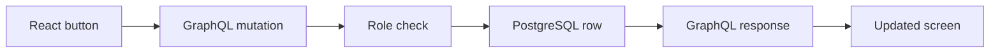

# Learn the project end to end

Work through this guide with the app open. The goal is to explain every request from click to database and back. Spend about 20–30 minutes per section, then change one small thing yourself.

## 1. Draw the path of one click



Open `src/main.tsx` and find `submit()`. Its `gql()` call sends the dataset ID and research purpose to `/graphql`. In `server/index.ts`, find the `requestAccess` resolver. It checks the role and inserts one row. The result comes back to React, which updates `requests` state.

**Try it:** Change the success message in `submit()`. Then change the minimum purpose length in both the UI and server. Why must the server still validate it? Because anyone can bypass the browser and call the API directly.

## 2. Learn the database

The `studies` table stores catalog metadata. The `access_requests` table references a study with a foreign key. `study_id` is the primary key in the request table, so this one-user demo allows one request per dataset. Status is constrained to `pending`, `approved`, or `denied`.

The SQL uses `$1`, `$2` parameters. Values are passed separately, so user-entered text is treated as data rather than SQL syntax.

**Try it:** Add a fifth synthetic study in the `seeds` array. Restart the API and confirm it appears in the catalog. Then add a `methodology` text field to the table and GraphQL type. This will teach you how database schema, API schema, and UI model must agree.

**Interview explanation:** “I used PostgreSQL constraints to protect the request states and parameterized queries for user input. For a quick local demo, PGlite runs the PostgreSQL engine without a separate database service. A deployed version would use a managed PostgreSQL instance.”

## 3. Learn GraphQL

`studies` and `requests` are queries because they read data. `requestAccess` and `decideAccess` are mutations because they change it. The React client requests only the fields it needs. The server resolver decides what data or action each operation is allowed to expose.

Open `http://localhost:4000/graphql` for the GraphQL explorer. Get a token with:

```graphql
mutation {
  login(role: "researcher", password: "research-demo-2026") { token role }
}
```

Send `Authorization: Bearer <token>` for protected operations. Run:

```graphql
query { studies { id title domain records } }
```

**Try it:** Remove the authorization header. The catalog should be denied. Use a researcher token to call `decideAccess`; it should be denied too.

## 4. Learn authorization

The role switch obtains a signed token from the backend. The browser's selected role is only presentation state; the server verifies the signature and expiry on each request. The `requireRole()` check protects admin approval. `/download/:id` checks both a researcher token and an approved database row before returning CSV bytes.

**Try it:** In browser developer tools, call `/download/BHP-001` without a token. Then call with a researcher token before approval. Both attempts must fail. Run `npm test` to see the automated approval-path check.

**Important limit:** The two credentials are publicly visible demo credentials, so this app is not appropriate for actual research data or public secure deployment. A production version needs institutional identity, user-specific request ownership, audit events, and security review.

## 5. Learn the S3 extension

Local mode returns a server-generated synthetic CSV. When `S3_BUCKET` is configured, the same endpoint first checks approval, then signs a `GetObject` request for a private synthetic file for 60 seconds. The browser never receives AWS credentials.

**Try it only if you have an AWS sandbox:** create a private bucket, upload a file named `synthetic/BHP-001.csv`, configure a narrowly scoped IAM identity, and set `S3_BUCKET` and `AWS_REGION`. Do not commit credentials. Verify denial before approval and a working presigned link afterward.

## 6. Learn the visualization boundary

The line graph is an illustrative React SVG of synthetic numbers. It is **not** QuickSight. To add QuickSight, create a dashboard from synthetic data, grant the appropriate registered user access, generate an embed URL on the backend, and render it through the official embedding SDK. Check account features and charges first. Keep the fallback chart labeled as synthetic.

## 7. Prepare to show the team

Record a 60–90 second walkthrough: catalog → request → admin approval → successful download. In the README and email, say exactly what is implemented. You can describe S3 or QuickSight as a completed integration only after you have configured and tested it. Be ready to explain why the role check belongs on the server and what you would change for real participant data.

## Implementation stages added September 28, 2026

The earlier walkthrough describes the original local prototype. The README status table is the authority for current verification. Production now has private sign-in and a managed PostgreSQL requirement; tests now use an isolated in-memory database. QuickSight and the model path have implementation code but have not been verified against live accounts.

| Stage | What changed / why it matters | How to test / small exercise |
| --- | --- | --- |
| Catalog + frontend | `src/main.tsx` includes `studies` in memo dependencies, loading/error retry, dialog focus trap/Escape, and role-aware actions. `src/style.css` adds readable text and focus indicators. Demonstrates React state and accessibility. | Reload catalog; compare four cards with Overview. Remove the dependency temporarily and explain why typing in Search repairs the symptom. Browser verification remains pending. |
| Backend | `server/database.ts` selects managed PostgreSQL via `DATABASE_URL`; production refuses local fallback. SQL is in `server/migrations/001-initial.sql`. Purpose length, roles, session integrity, and approvals are checked server-side. | Run tests; trace a request from GraphQL input to parameterized INSERT. Explain why disabling a button is not authorization. |
| Tests | `server/portal.test.ts` calls the actual HTTP download endpoint, not only an authorization helper. | Run `npm test`. Add a CSV header assertion against catalog fields. Explain the difference between unit and integration coverage. |
| S3 | `server/index.ts` signs a private object GET only after approval. `server/synthetic.ts` creates reproducible local fixtures matching catalog fields/counts. | Follow `docs/AWS_SETUP.md` when AWS is available. Explain why the 60-second URL is temporarily a bearer credential. Live S3 remains unverified. |
| QuickSight | `server/dashboard.ts` generates registered-user embed URLs on the server; React retains an honest chart fallback. | Explain why an AWS-generated URL is not evidence the dashboard rendered. Complete the browser checklist before calling it live. |
| Recommendations | `server/recommendations.ts` retrieves metadata, validates IDs/fields, limits to two, and builds factual rationales. `src/ResearchSearch.tsx` lets humans inspect before requesting. | Compare “sleep” and “genetics.” Add a test for a made-up field; explain why JSON schema alone does not establish grounding. |
| Deployment | `render.yaml`, `.env.example`, and `docs/DEPLOYMENT.md` define same-origin hosting, health check, private credentials, and persistent storage. | Explain what would happen to requests if stored on an ephemeral web-service disk. Live deployment is still pending account/browser access. |

### Collaboration exercise

Ask a researcher to describe what metadata they need before requesting access, and ask a designer to review the keyboard and mobile workflow. Record their actual feedback and one resulting change. Do not claim researcher/designer collaboration until it has occurred. This prototype currently demonstrates a workflow intended for such review, not completed stakeholder research.
